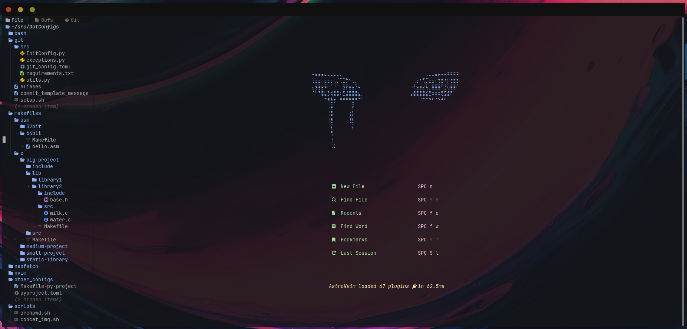
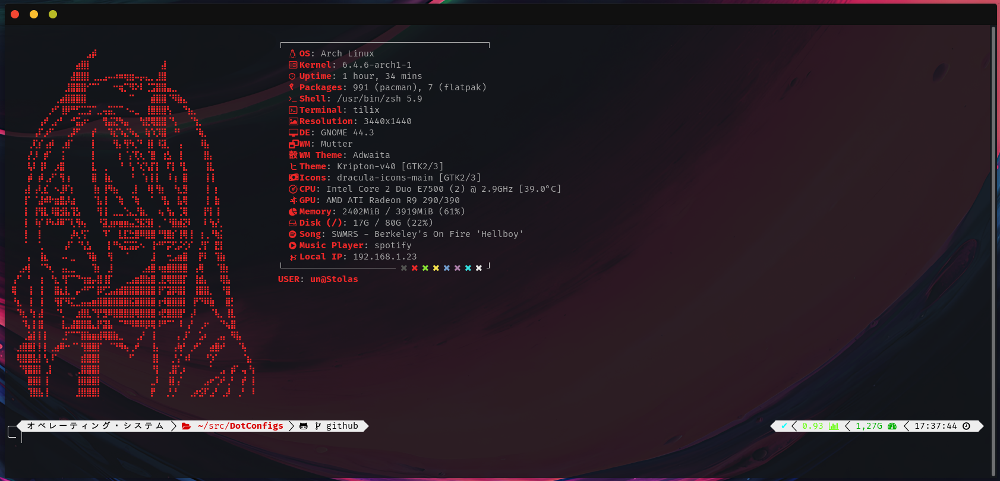

# DotFiles

My configuration files and setup scripts for Windows and Unix. The maintained
Neovim profile targets Windows 11 x64. The repository also preserves earlier
shell, editor and terminal configurations.

## Windows Neovim

The profile includes a file tree, AstroNvim-style keybindings, and language tools
for Python, Go, Markdown, YAML and TOML. Follow the
[Neovim setup guide](nvim/README.md) to prepare, install or restore the profile.
The [test guide](tests/README.md) explains how to check it in an isolated profile
and how to run the Windows checks locally.

## Earlier configurations

- [Shell and terminal](zsh/): Zsh, [tmux](tmux/) and [Alacritty](tty/alacritty/).
- [Editor settings](vim/): Vim and [earlier Neovim profiles](nvim/legacy/).
- [Development tools](git/): Git, [Clang](clang/) and [Makefile examples](makefiles/).
- [Utility scripts](scripts/README.md): Unix and shared scripts alongside the Windows checks.

These earlier configurations are outside the current Windows test suite.

## Screenshots

## License

[MIT](./LICENSE) © [Ivan Kovach](https://github.com/Qu1nel/)
